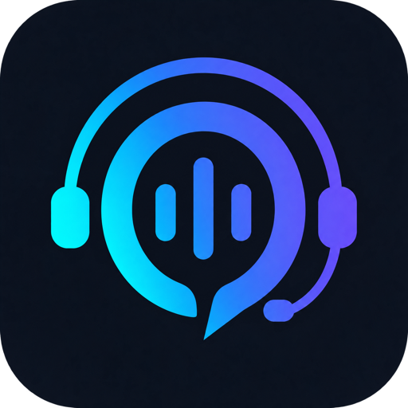
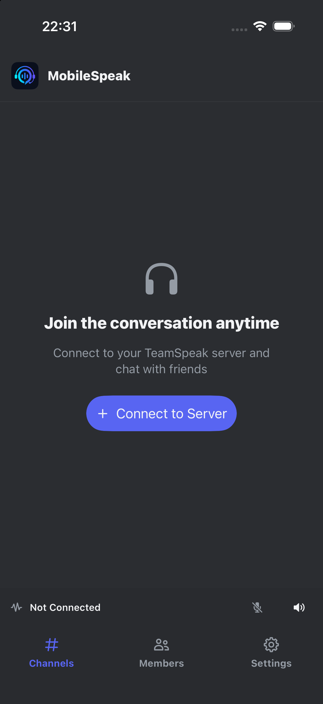
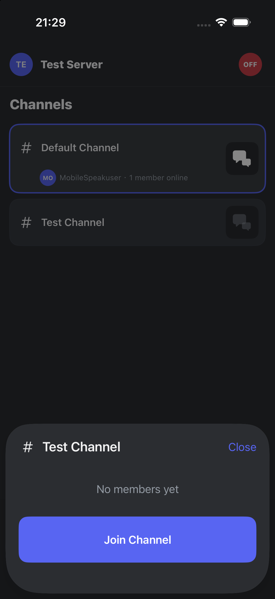
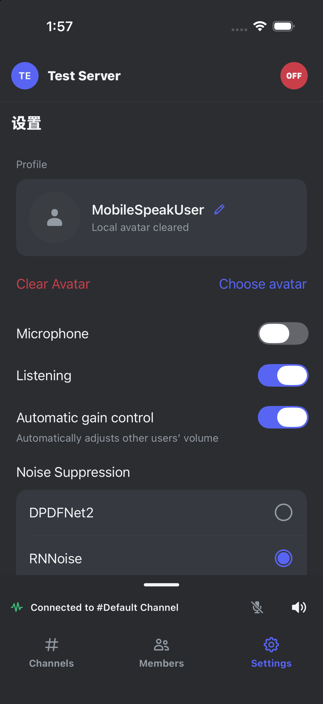

  
  <h1>MobileSpeak</h1>

<h2 align="center">Screenshots</h2>

  
  
  

<h2 align="center">Supported Languages</h2>

  简体中文 · 繁體中文 · English · Deutsch · Русский · Polski 
  Español · Español (México) · Français · Português (Brasil)

<h2 align="center">Current Feature Support</h2>

<table align="center">
  <thead>
    <tr>
      <th style="vertical-align: middle; text-align: center;">Feature</th>
      <th style="vertical-align: middle; text-align: center;">TeamSpeak</th>
      <th style="vertical-align: middle; text-align: center;">MobileSpeak</th>
    </tr>
  </thead>
  <tbody>
    <tr><td style="vertical-align: middle; text-align: center;">Direct server connections</td><td style="vertical-align: middle; text-align: center;">✅</td><td style="vertical-align: middle; text-align: center;">✅</td></tr>
    <tr><td style="vertical-align: middle; text-align: center;">Server bookmarks</td><td style="vertical-align: middle; text-align: center;">✅</td><td style="vertical-align: middle; text-align: center;">✅</td></tr>
    <tr><td style="vertical-align: middle; text-align: center;">Saved server passwords</td><td style="vertical-align: middle; text-align: center;">✅</td><td style="vertical-align: middle; text-align: center;">✅</td></tr>
    <tr><td style="vertical-align: middle; text-align: center;">Identity authentication and persistence</td><td style="vertical-align: middle; text-align: center;">✅</td><td style="vertical-align: middle; text-align: center;">✅</td></tr>
    <tr><td style="vertical-align: middle; text-align: center;">Automatic reconnection</td><td style="vertical-align: middle; text-align: center;">✅</td><td style="vertical-align: middle; text-align: center;">✅</td></tr>
    <tr><td style="vertical-align: middle; text-align: center;">Connection quality indicators</td><td style="vertical-align: middle; text-align: center;">✅</td><td style="vertical-align: middle; text-align: center;">✅</td></tr>
    <tr><td style="vertical-align: middle; text-align: center;">Discover, search, and join public communities (TeamSpeak 6 only)</td><td style="vertical-align: middle; text-align: center;">✅</td><td style="vertical-align: middle; text-align: center;">❌</td></tr>
    <tr><td style="vertical-align: middle; text-align: center;">Browse channels and subchannels</td><td style="vertical-align: middle; text-align: center;">✅</td><td style="vertical-align: middle; text-align: center;">✅</td></tr>
    <tr><td style="vertical-align: middle; text-align: center;">Join channels</td><td style="vertical-align: middle; text-align: center;">✅</td><td style="vertical-align: middle; text-align: center;">✅</td></tr>
    <tr><td style="vertical-align: middle; text-align: center;">Join password-protected channels</td><td style="vertical-align: middle; text-align: center;">✅</td><td style="vertical-align: middle; text-align: center;">✅</td></tr>
    <tr><td style="vertical-align: middle; text-align: center;">Voice communication</td><td style="vertical-align: middle; text-align: center;">✅</td><td style="vertical-align: middle; text-align: center;">✅</td></tr>
    <tr><td style="vertical-align: middle; text-align: center;">Protocol encryption and secure identities</td><td style="vertical-align: middle; text-align: center;">✅</td><td style="vertical-align: middle; text-align: center;">✅</td></tr>
    <tr><td style="vertical-align: middle; text-align: center;">Audio codec selection</td><td style="vertical-align: middle; text-align: center;">✅</td><td style="vertical-align: middle; text-align: center;">❌</td></tr>
    <tr><td style="vertical-align: middle; text-align: center;">Automatic microphone gain control</td><td style="vertical-align: middle; text-align: center;">✅</td><td style="vertical-align: middle; text-align: center;">✅ (requires system support)</td></tr>
    <tr><td style="vertical-align: middle; text-align: center;">Per-user volume control</td><td style="vertical-align: middle; text-align: center;">✅</td><td style="vertical-align: middle; text-align: center;">✅</td></tr>
    <tr><td style="vertical-align: middle; text-align: center;">Background noise suppression</td><td style="vertical-align: middle; text-align: center;">✅</td><td style="vertical-align: middle; text-align: center;">✅</td></tr>
    <tr><td style="vertical-align: middle; text-align: center;">Echo cancellation</td><td style="vertical-align: middle; text-align: center;">✅</td><td style="vertical-align: middle; text-align: center;">✅</td></tr>
    <tr><td style="vertical-align: middle; text-align: center;">Microphone mute</td><td style="vertical-align: middle; text-align: center;">✅</td><td style="vertical-align: middle; text-align: center;">✅</td></tr>
    <tr><td style="vertical-align: middle; text-align: center;">Mute incoming audio</td><td style="vertical-align: middle; text-align: center;">✅</td><td style="vertical-align: middle; text-align: center;">✅</td></tr>
    <tr><td style="vertical-align: middle; text-align: center;">Positional audio (TeamSpeak 3 only)</td><td style="vertical-align: middle; text-align: center;">✅</td><td style="vertical-align: middle; text-align: center;">❌</td></tr>
    <tr><td style="vertical-align: middle; text-align: center;">Channel text chat</td><td style="vertical-align: middle; text-align: center;">✅</td><td style="vertical-align: middle; text-align: center;">✅</td></tr>
    <tr><td style="vertical-align: middle; text-align: center;">One-to-one private chat</td><td style="vertical-align: middle; text-align: center;">✅</td><td style="vertical-align: middle; text-align: center;">✅</td></tr>
    <tr><td style="vertical-align: middle; text-align: center;">Group chat (TeamSpeak 6 only)</td><td style="vertical-align: middle; text-align: center;">✅</td><td style="vertical-align: middle; text-align: center;">❌</td></tr>
    <tr><td style="vertical-align: middle; text-align: center;">Contact management and search (TeamSpeak 6 only)</td><td style="vertical-align: middle; text-align: center;">✅</td><td style="vertical-align: middle; text-align: center;">❌</td></tr>
    <tr><td style="vertical-align: middle; text-align: center;">Unread message indicators</td><td style="vertical-align: middle; text-align: center;">✅</td><td style="vertical-align: middle; text-align: center;">✅</td></tr>
    <tr><td style="vertical-align: middle; text-align: center;">Chat history</td><td style="vertical-align: middle; text-align: center;">✅</td><td style="vertical-align: middle; text-align: center;">✅</td></tr>
    <tr><td style="vertical-align: middle; text-align: center;">Avatars, badges, and server/channel group icons</td><td style="vertical-align: middle; text-align: center;">✅</td><td style="vertical-align: middle; text-align: center;">✅</td></tr>
    <tr><td style="vertical-align: middle; text-align: center;">Change your avatar</td><td style="vertical-align: middle; text-align: center;">✅</td><td style="vertical-align: middle; text-align: center;">✅</td></tr>
    <tr><td style="vertical-align: middle; text-align: center;">File, image, and link sharing (TeamSpeak 6 only)</td><td style="vertical-align: middle; text-align: center;">✅</td><td style="vertical-align: middle; text-align: center;">❌</td></tr>
    <tr><td style="vertical-align: middle; text-align: center;">File transfers</td><td style="vertical-align: middle; text-align: center;">✅</td><td style="vertical-align: middle; text-align: center;">✅</td></tr>
    <tr><td style="vertical-align: middle; text-align: center;">Create and manage channels and subchannels</td><td style="vertical-align: middle; text-align: center;">✅</td><td style="vertical-align: middle; text-align: center;">❌</td></tr>
    <tr><td style="vertical-align: middle; text-align: center;">Hierarchical permission system</td><td style="vertical-align: middle; text-align: center;">✅</td><td style="vertical-align: middle; text-align: center;">❌</td></tr>
    <tr><td style="vertical-align: middle; text-align: center;">Server and channel group management</td><td style="vertical-align: middle; text-align: center;">✅</td><td style="vertical-align: middle; text-align: center;">❌</td></tr>
    <tr><td style="vertical-align: middle; text-align: center;">Kick and ban management</td><td style="vertical-align: middle; text-align: center;">✅</td><td style="vertical-align: middle; text-align: center;">❌</td></tr>
    <tr><td style="vertical-align: middle; text-align: center;">Screen sharing (TeamSpeak 6 only)</td><td style="vertical-align: middle; text-align: center;">✅</td><td style="vertical-align: middle; text-align: center;">❌</td></tr>
    <tr><td style="vertical-align: middle; text-align: center;">Webcam and live video (TeamSpeak 6 only)</td><td style="vertical-align: middle; text-align: center;">✅</td><td style="vertical-align: middle; text-align: center;">❌</td></tr>
    <tr><td style="vertical-align: middle; text-align: center;">Create and host community servers via Communities (TeamSpeak 6 only)</td><td style="vertical-align: middle; text-align: center;">✅</td><td style="vertical-align: middle; text-align: center;">❌</td></tr>
    <tr><td style="vertical-align: middle; text-align: center;">In-game overlay</td><td style="vertical-align: middle; text-align: center;">✅</td><td style="vertical-align: middle; text-align: center;">❌</td></tr>
    <tr><td style="vertical-align: middle; text-align: center;">Plugins, extensions, themes, and font customization</td><td style="vertical-align: middle; text-align: center;">✅</td><td style="vertical-align: middle; text-align: center;">❌</td></tr>
    <tr><td style="vertical-align: middle; text-align: center;">myTeamSpeak account and cross-device sync</td><td style="vertical-align: middle; text-align: center;">✅</td><td style="vertical-align: middle; text-align: center;">❌</td></tr>
  </tbody>
</table>

<h2 align="center">License</h2>

Original content in MobileSpeak is licensed under the [MIT License](LICENSE). Third-party code, models, and assets are subject to their respective licenses. See [Third-Party Notices](THIRD_PARTY_NOTICES.md) and the [licenses](licenses/) directory for details.

<h2 align="center">Star History</h2>

  <a href="https://star-history.com/#langstaffe/MobileSpeak&amp;Date">
    <picture>
      <source media="(prefers-color-scheme: dark)" srcset="https://api.star-history.com/svg?repos=langstaffe/MobileSpeak&amp;type=Date&amp;theme=dark">
      
    </picture>
  </a>

